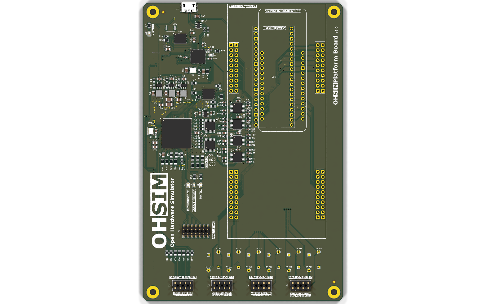
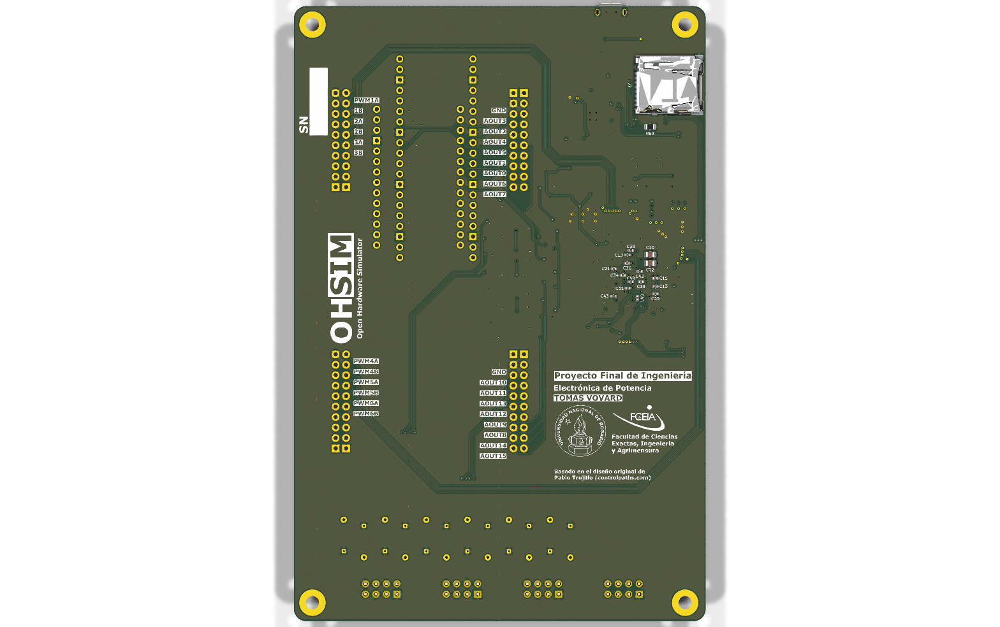

# Hardware: placa OHSIM (Platform Board)

Proyecto KiCad de la placa de simulación en tiempo real (*hardware-in-the-loop*) OHSIM, basada en una FPGA AMD Spartan-7 XC7S50 (encapsulado FTGB196, que admite desde la XC7S15 hasta la XC7S50). La placa tiene 16 salidas analógicas de 12 bits (dos DAC AD5328 de ocho canales con buffers), entradas y salidas digitales y de PWM y un RP2040 para la administración de la plataforma. Se conecta a placas de desarrollo comerciales para ensayar lazos de control sobre modelos de convertidores:

- Arduino MKR / Portenta
- Raspberry Pi Pico (1 y 2)
- Texas Instruments LaunchPad (en este trabajo se usó la LAUNCHXL-F28379D)

| Cara superior | Cara inferior |
|---|---|
|  |  |

## Origen y revisión

El diseño original es la *Platform Board* del proyecto OHSIM (versión 0.1 en su serigrafía) de Pablo Trujillo ([controlpaths.com](https://controlpaths.com/)). Esta carpeta contiene su rediseño, hecho en este proyecto final. La procedencia y las licencias se detallan en [`AUTHORS.md`](../AUTHORS.md).

- **Esquemáticos: revisión 3.2.** Las revisiones 3.1 y 3.2 solo reorganizan los esquemáticos (rótulo, títulos por hoja y hoja raíz) y no cambian el netlist.
- **PCB: revisión 3.0**, la fabricada y ensayada. El PCB de esta carpeta agrega en la serigrafía inferior la leyenda "Basado en el diseño original de Pablo Trujillo (controlpaths.com)". No cambia el cobre y el DRC da los mismos resultados que el de la placa fabricada, por lo que es eléctricamente idéntico.
- Las salidas de [`fabricacion/`](fabricacion/) son las que se enviaron al fabricante para la placa 3.0 y, por lo tanto, **no incluyen esa leyenda**. Para fabricar una placa con la leyenda, regenerarlas desde KiCad (ver [Uso](#uso)).

## Contenido

| Archivo | Contenido |
|---|---|
| `ohsim_launchpad.kicad_pro` | Proyecto KiCad |
| `ohsim_launchpad.kicad_sch` | Hoja raíz (diagrama general) |
| `supply.kicad_sch` | Fuentes de alimentación (3V3, 1V8, 1V0) |
| `fpga_power.kicad_sch` | FPGA: alimentación, configuración y JTAG |
| `fpga_bank.kicad_sch` | FPGA: bancos de E/S |
| `rp2040.kicad_sch` | Microcontrolador RP2040, memoria flash y microSD |
| `dac.kicad_sch`, `dac1.kicad_sch` | DAC 0 y DAC 1 con buffers (AOUT0 a AOUT7 y AOUT8 a AOUT15) |
| `arduino.kicad_sch`, `rp_pico.kicad_sch`, `ti_launchpad.kicad_sch` | Interfaces con las placas de desarrollo |
| `ohsim_launchpad.kicad_pcb` | PCB de cuatro capas |
| `ohsim_rotulo.kicad_wks` | Rótulo de las hojas del esquemático |
| `ohsim_launchpad.pdf` | Esquemáticos en PDF |
| `lib/` | Símbolos, huellas y modelos 3D que no forman parte de las bibliotecas estándar de KiCad (ver [Bibliotecas de terceros](#bibliotecas-de-terceros)) |
| `fabricacion/` | Gerbers y perforaciones (`ohsim_launchpad.zip`), BOM, posiciones de montaje (CPL), designadores y netlist IPC de la placa fabricada |
| `img/` | Renders de la placa y logos usados en la serigrafía |

## Uso

Herramienta: **KiCad 9.0**. Las bibliotecas propias se referencian con `${KIPRJMOD}`, de modo que el proyecto abre desde cualquier ubicación sin configurar rutas. Los modelos 3D estándar se toman de las variables `KICAD8_3DMODEL_DIR` y `KICAD9_3DMODEL_DIR` de la instalación de KiCad. La serigrafía usa la fuente Orbitron; si no está instalada, KiCad la reemplaza en pantalla, pero los Gerbers deben generarse con ella instalada.

1. Abrir `ohsim_launchpad.kicad_pro` con KiCad 9.
2. Para revisar el diseño, correr el ERC en el editor de esquemáticos y el DRC en el editor de PCB. El DRC informa cinco observaciones conocidas y aceptadas (cuatro solapamientos de serigrafía y una huella de tipo pasante con pads SMD) y ningún pad sin conectar.
3. Para regenerar las salidas de fabricación, usar *Archivo → Salidas de fabricación* (Gerber, perforaciones, BOM y posiciones), o desde la línea de comandos:

```
kicad-cli pcb export gerbers -o salidas/ ohsim_launchpad.kicad_pcb
kicad-cli pcb export drill -o salidas/ ohsim_launchpad.kicad_pcb
kicad-cli pcb export pos --format csv --units mm -o salidas/posiciones.csv ohsim_launchpad.kicad_pcb
```

La BOM de `fabricacion/bom.csv` incluye la columna `LCSC Part #` con los números de parte usados en el ensamblado. La FPGA (U1) figura como XC7S50-1FTGB196C, la de la placa ensayada, sin número de parte LCSC; la BOM original del pedido la listaba como XC7S25.

## Historial de revisiones

### 3.2 (esquemáticos)
- Rótulo nuevo, títulos descriptivos por hoja y reorganización visual de la hoja raíz. La hoja de alimentación pasa a formato A4. Sin cambios eléctricos.
- PCB: leyenda de atribución al diseño original en la serigrafía inferior. Sin cambios en el cobre.

### 3.0 (PCB fabricado)
- Se unificaron los encapsulados de los componentes eléctricamente iguales y se rehízo la cara inferior priorizando caminos cortos a GND en los capacitores de desacople.
- Se revisaron y completaron los números de parte LCSC y los encapsulados de todos los componentes.
- Se cableó la señal DONE_RP2040 con R69 (0 Ω, no montada) para futuras versiones del firmware del microcontrolador.
- Se reemplazaron los conectores RJ45 por tiras de pines macho de 2 × 4 con paso de 2,54 mm, con todas las señales analógicas rodeadas por GND.
- Se agregaron puntos de prueba con la distribución de una punta de osciloscopio con resorte de GND (Rigol PVP2350).
- Se quitó el recubrimiento de las vías de PWM y de los buses de tensión para usarlas como puntos de prueba, con vías de GND descubiertas cercanas.
- Se agregó la serigrafía de la Universidad, la Facultad, la cátedra y el autor del rediseño.

### 2
- Pistas de alimentación de la FPGA de 0,2 mm de ancho.
- Huellas de componentes pasivos entre 0603 y 0805.
- Vías reubicadas para que no interfieran con los pads de soldadura.

### 1
- Vías debajo de la FPGA reubicadas para que no interfieran con los pads de soldadura.

## Bibliotecas de terceros

La carpeta `lib/` incluye bibliotecas y modelos de terceros, en su mayoría heredados del diseño original. No están cubiertos por la licencia de esta carpeta y conservan la de su autor:

| Archivos | Origen |
|---|---|
| `arduino-library.kicad_sym`, `arduino-library.pretty/` | Biblioteca KiCad de placas Arduino |
| `ABX00042.kicad_sym`, `MODULE_ABX00042.kicad_mod` | Arduino Portenta H7 (ABX00042, SnapEDA) |
| `MCU_RaspberryPi_and_Boards.kicad_sym`, `MCU_RaspberryPi_and_Boards.pretty/`, `Pico.wrl` | Biblioteca KiCad para Raspberry Pi Pico de Nicolò Carandini |
| `LAUNCHXL-F28379D.kicad_sym`, `MOD_LAUNCHXL-F28379D.kicad_mod` | LaunchPad LAUNCHXL-F28379D de Texas Instruments (SnapEDA) |
| `xilinx7.lib` | Símbolos de la familia Xilinx 7 |
| `DM3AT-SF-PEJM5--3DModel-STEP-418109.STEP` | Modelo de fabricante (Hirose) |
| `LQH3NPN2R2MMEL.step`, `IND_LQH3NPN2R2MMEL.kicad_mod` | Modelo y huella de fabricante (Murata) |

## Licencia

El diseño de hardware de esta carpeta se distribuye bajo la licencia [CERN-OHL-S-2.0](LICENSE). Las bibliotecas de terceros mantienen la suya.
